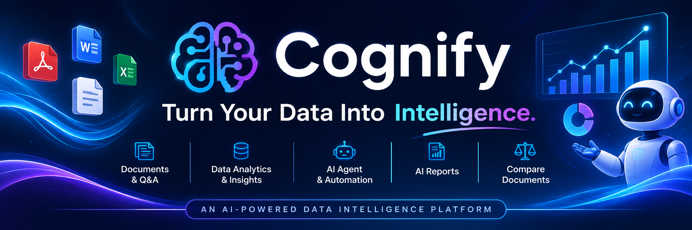

\# Cognify — AI Data Intelligence Platform


<p align="center">

&#x20; <strong>Turn documents and datasets into actionable insights with AI.</strong>

</p>


<p align="center">

&#x20; An AI-powered data intelligence platform built with Angular, FastAPI, SQL Server and Anthropic Claude.

</p>


<p align="center">

&#x20; 

&#x20; 

&#x20; 

&#x20; 

&#x20; 

</p>


\---


\## Overview


Cognify is an AI-powered data intelligence platform that helps users work with documents and structured datasets in one place.


Users can upload documents, ask natural-language questions, explore datasets, generate visual insights, compare documents, create AI reports, and automate analysis through an AI agent.


The project combines a modern Angular frontend with a Python FastAPI backend, Microsoft SQL Server, and Anthropic Claude.


\*\*Project status:\*\* Actively developed personal portfolio project. Features and architecture may evolve as development continues. This repository showcases development work, technical decisions, and ongoing learning.


\## Application Screenshots


\### Library Dashboard

!\[Cognify Library Dashboard](screenshots/library-dashboard.png)


\### Ask AI

!\[Cognify Ask AI](screenshots/ask-ai.png)


\### Data Analytics

!\[Cognify Data Analytics](screenshots/data.png)


\### Additional Data View

!\[Cognify Data View](screenshots/data-2.png)


\### Document Comparison

!\[Cognify Document Comparison](screenshots/compare-documents.png)


\### AI Agent

!\[Cognify AI Agent](screenshots/agent.png)


\### AI Reports

!\[Cognify Reports](screenshots/reports.png)


\### Dark Theme

!\[Cognify Dark Theme](screenshots/dark-theme.png)


\---


\## Features


\### Document Intelligence

\- Upload PDF, DOCX, TXT, Markdown, CSV, and XLSX files.

\- Process uploaded documents in the background.

\- Ask natural-language questions about uploaded content.

\- Retrieve relevant passages to support AI-generated answers.

\- View previous questions and answers.

\- Compare two documents using AI.


\### Data Analytics

\- Upload structured datasets.

\- Explore dataset information and metadata.

\- Generate bar, line, histogram, and scatter charts.

\- Generate AI-powered dataset insights.


\### AI Reports

\- Generate reports using uploaded documents and custom instructions.

\- View previously generated reports.

\- Delete reports.


\### AI Agent

\- Submit goals to an AI agent.

\- Track agent execution steps and results.

\- Receive live document-processing and agent updates through Server-Sent Events (SSE).


\### Authentication

\- User registration and login.

\- JWT-based authentication.

\- User-specific document and report access.


\## Technology Stack


| Layer | Technologies |

|---|---|

| Frontend | Angular 22, TypeScript, SCSS |

| Backend | Python 3.14, FastAPI |

| Database | Microsoft SQL Server |

| ORM | SQLAlchemy |

| AI | Anthropic Claude |

| Data Processing | Python data-processing libraries |

| Data Visualization | Chart.js |

| Authentication | JWT |

| Live Updates | Server-Sent Events |

| API Documentation | Swagger / OpenAPI |


\## Architecture


```mermaid

flowchart TD

&#x20;   U\[User] --> FE\[Angular 22 Frontend]


&#x20;   FE -->|HTTP / REST API| API\[FastAPI Backend]


&#x20;   API --> AUTH\[Authentication]

&#x20;   API --> DOC\[Document Intelligence]

&#x20;   API --> DATA\[Data Analytics]

&#x20;   API --> AGENT\[AI Agent]

&#x20;   API --> REPORT\[AI Reports]


&#x20;   DOC --> AI\[Anthropic Claude]

&#x20;   AGENT --> AI

&#x20;   REPORT --> AI


&#x20;   DOC --> DB\[(Microsoft SQL Server)]

&#x20;   DATA --> DB

&#x20;   AUTH --> DB

&#x20;   REPORT --> DB


&#x20;   API --> SSE\[Server-Sent Events]

&#x20;   SSE --> FE

```


The Angular frontend communicates with the FastAPI backend through REST APIs. The backend handles authentication, document processing, analytics, AI interactions, and persistence. Server-Sent Events provide live updates to the frontend.


\## Project Structure


```text

Cognify/

├── backend/

│   ├── app/

│   │   ├── routes/

│   │   ├── services/

│   │   ├── config.py

│   │   ├── db.py

│   │   ├── main.py

│   │   ├── models.py

│   │   └── security.py

│   ├── requirements.txt

│   └── .env.example

│

├── frontend/

│   ├── src/

│   │   └── app/

│   │       ├── core/

│   │       ├── pages/

│   │       └── shared/

│   ├── angular.json

│   └── package.json

│

├── screenshots/

│   ├── agent.png

│   ├── ask-ai.png

│   ├── compare-documents.png

│   ├── dark-theme.png

│   ├── data.png

│   ├── data-2.png

│   ├── library-dashboard.png

│   └── reports.png

│

├── .gitignore

└── README.md

```


\## Getting Started


\### Prerequisites


\- Python 3.14

\- Node.js 22.22.3 or later

\- Microsoft SQL Server

\- ODBC Driver 18 for SQL Server

\- Anthropic API key


\### 1. Clone the repository


```bash

git clone https://github.com/sumeetshah30/Cognify.git

cd Cognify

```


\### 2. Configure the backend


```powershell

cd backend


python -m venv .venv

.venv\\Scripts\\Activate.ps1


pip install -r requirements.txt


Copy-Item .env.example .env

```


Update `backend/.env` with your local database connection, Anthropic API key, and JWT secret.


Create an empty SQL Server database named `cognify` before starting the backend.


Start the API:


```powershell

uvicorn app.main:app --reload --port 8000

```


API documentation:


http://localhost:8000/docs


Health check:


http://localhost:8000/api/health


\### 3. Configure the frontend


Open a second terminal:


```powershell

cd frontend


npm install

npm start

```


Open the application:


http://localhost:4200


The frontend expects the backend API at:


http://localhost:8000/api


\## Environment Variables


Create `backend/.env` using `backend/.env.example`.


| Variable | Description |

|---|---|

| `DATABASE\_URL` | SQL Server database connection |

| `ANTHROPIC\_API\_KEY` | Anthropic API key |

| `CLAUDE\_MODEL` | Claude model identifier |

| `JWT\_SECRET` | Secret used for JWT authentication |


\*\*Security:\*\* Never commit `.env` files, API keys, passwords, or other private credentials.


\## Roadmap


\- Improve document processing and retrieval.

\- Expand AI agent capabilities.

\- Enhance analytics and visualizations.

\- Improve error handling and application reliability.

\- Add automated backend and frontend tests.

\- Explore additional AI-powered workflows.


\## Disclaimer


Cognify is a personal development and portfolio project. It is not presented as a production-ready enterprise application. Configuration, security, reliability, and deployment capabilities may require further work before production use.


\## Author


\*\*Sumeet Shah\*\*


\- GitHub: \[@sumeetshah30](https://github.com/sumeetshah30)

\- Portfolio: \[sumeetshah30.github.io](https://sumeetshah30.github.io)

\- LinkedIn: \[linkedin.com/in/sumeet-shah30](https://linkedin.com/in/sumeet-shah30)


\---


<p align="center">

&#x20; Built with curiosity and a passion for AI-powered software.

</p>

